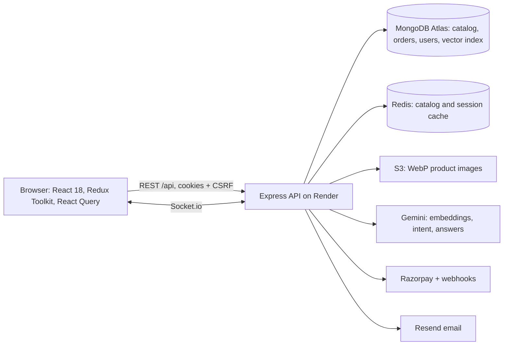

# VKart

VKart is a full-stack e-commerce portfolio project: a 264-product catalog across 14 categories, AI-assisted search, a real checkout in Razorpay test mode, Prime membership, price and stock alerts, and an admin panel with role-based access. It is built to behave like a real store, not a demo page.

- **Live site:** https://vkartshop.netlify.app
- **Frontend (this repo):** https://github.com/vardhan12178/vkart
- **Backend:** https://github.com/vardhan12178/backend

## Try it in 60 seconds

No sign-up needed. On the login page, press **Try the demo shopper**; on `/admin/login`, press **Explore the admin demo**.

| Demo | What you can do | Limits |
| --- | --- | --- |
| Shopper | Browse, search, compare, add to bag, check out with Razorpay test cards, track the order | Can't change the shared account's password or 2FA |
| Admin | Products, orders, coupons, sales and membership dashboards | Strictly read-only; customer data, staff, support chats and settings are hidden |

Try asking the search bar something in plain language, like *"phones under 30000"* or *"earbuds for the gym"*, then open **Ask VKart** for the AI assistant.

## What's inside

- **Catalog:** variants (colour, storage, size) with their own price, stock and images; faceted filters that update with the other filters applied; rating and discount sorting; sale pricing per category that never raises a price.
- **Search:** header suggestions (recent searches, categories, products), natural-language queries parsed into filters, and a hybrid AI assistant (below).
- **Shopping:** quick add, mini cart with a free-delivery meter, delivery estimate by pincode (India Post data), offers and EMI, size guide, Compare (up to four products), recently viewed and recommended rows, wishlist.
- **Alerts:** price-drop and back-in-stock alerts by email.
- **Checkout:** Razorpay with webhook-confirmed payments, wallet, coupons, refunds on cancellation.
- **Admin:** catalog manager with bulk publish, orders, coupons, sales, membership, employees with per-module permissions, support inbox, live notifications over Socket.io.
- **Installable:** a PWA with an offline page; skeleton loading states on every page; bottom tab bar on phones.

## Architecture



### How Ask VKart answers

1. **Intent:** one model call turns the chat into a standalone query plus validated filters (category, brand, price, RAM, battery).
2. **Retrieve:** Atlas `$vectorSearch` (with the filters inside the search) and `$text` keyword search run in parallel and are fused with Reciprocal Rank Fusion. If one side fails, the other still answers.
3. **Rerank and answer:** the top 10 are reranked into at most 4 picks with a reason for each; invalid model output falls back to the fused order. If the filters leave nothing, they are relaxed and the answer says so.
4. **Measure:** `npm run catalog:eval` in the backend runs 24 labelled queries and prints Recall@4 and MRR for keyword-only, vector-only and hybrid, so changes can be compared with numbers instead of opinions.

## Engineering notes

- **Prices stay honest:** sale prices are computed from MRP per request and cached per active sale, so a sale ending can't leave stale prices behind.
- **Stock is reserved atomically** per variant at checkout and restored on cancellation, which also fires back-in-stock alerts.
- **Security:** HTTP-only cookies, CSRF tokens, rate limits, helmet, token revocation, optional 2FA, and RBAC checked against the database on every admin request.
- **Demo accounts are safe by construction:** their passwords are random and unknown, sign-in happens only through server endpoints, and the demo admin's token is rejected on every write.
- **Tests:** ~415 frontend tests and ~370 backend tests (Jest, Testing Library, Supertest, mongodb-memory-server) run in CI on every pull request.

## Tech stack

| Layer | Technologies |
| --- | --- |
| Frontend | React 18, Vite, Tailwind CSS, Redux Toolkit, TanStack Query, React Router 6, Framer Motion, lucide icons |
| Backend | Node.js, Express, MongoDB (Atlas Search and Vector Search), Mongoose, Redis, Socket.io |
| Services | Razorpay, Google OAuth, Gemini, AWS S3, Resend |
| Hosting | Netlify (frontend), Render (backend), MongoDB Atlas |

## Local Setup

### 1. Clone both repos

```bash
git clone https://github.com/vardhan12178/vkart.git
git clone https://github.com/vardhan12178/backend.git
```

### 2. Start the backend

```bash
cd backend
npm install
npm start
```

Create `backend/.env` with the backend values you use locally, for example:

```env
PORT=5000
MONGO_URI=your_mongodb_connection_string
REDIS_URL=your_redis_url
JWT_SECRET=your_secret_key
AES_KEY=your_32_byte_aes_key

RAZORPAY_KEY_ID=your_razorpay_key
RAZORPAY_KEY_SECRET=your_razorpay_secret
RAZORPAY_WEBHOOK_SECRET=your_razorpay_webhook_secret

AWS_ACCESS_KEY_ID=your_aws_key
AWS_SECRET_ACCESS_KEY=your_aws_secret
AWS_REGION=ap-south-1
S3_BUCKET=your_s3_bucket

GEMINI_API_KEY=your_gemini_api_key

RESEND_API_KEY=your_resend_key
FROM_EMAIL=noreply@yourdomain.com

GOOGLE_CLIENT_ID=your_google_client_id
```

### 3. Start the frontend

```bash
cd vkart
npm install
npm run dev
```

Create `vkart/.env` with:

```env
REACT_APP_API_BASE_URL=http://localhost:5000
VITE_DEV_API_PROXY=http://localhost:5000
REACT_APP_GOOGLE_CLIENT_ID=your_google_client_id
REACT_APP_RAZORPAY_KEY_ID=your_razorpay_key_id
```

### 4. Local URLs

- Frontend: http://localhost:3000
- Backend: http://localhost:5000

## Available Scripts

```bash
npm run dev
npm run build
npm test
npm run preview
```

## Testing

### Frontend

```bash
npm test -- --runInBand
```

Current frontend coverage includes login, forgot/reset password, checkout payment, and order payload tests.

### Backend

```bash
cd backend
npm test
```

Backend tests use Jest, Supertest, and mongodb-memory-server.

## Deployment Notes

- The frontend is built with Vite.
- Dev requests to `/api` and `/socket.io` are proxied to the backend server.
- Production builds are generated into `dist/`.

## Frontend Structure

```text
vkart/
├── public/
├── src/
│   ├── components/
│   │   ├── admin/
│   │   ├── blog/
│   │   └── ...
│   ├── query/
│   ├── redux/
│   ├── seo/
│   └── utils/
├── index.html
├── vite.config.mjs
└── package.json
```

Author: Bala Vardhan
